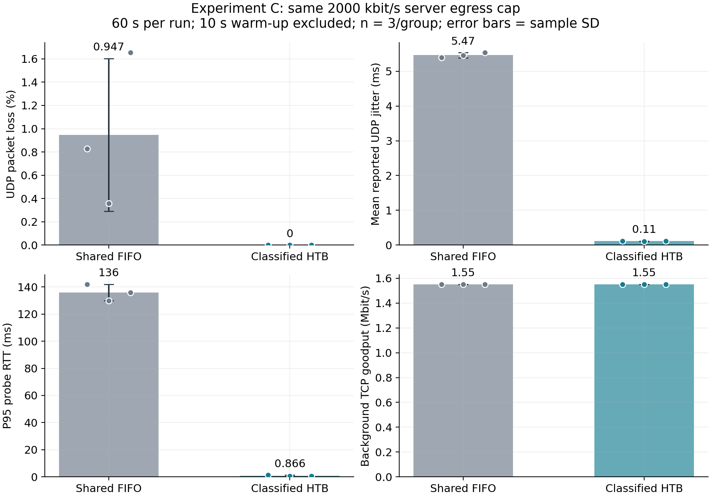

# 6号实验C交付

版本：v1.0，2026年11月9日。模块：混合业务与服务器出口QoS保障。

本次在已部署的双AP平台上完成下行容量标定，以及共享FIFO与分类HTB两组正式对照。每组3次、每次60秒，统计后50秒，6轮均为PASS。

## 结果概览

两组出口总上限均为2 Mbit/s，UDP发送300 kbit/s，后台为持续TCP。下表为3轮指标的均值。

| 指标 | 同限速共享FIFO | 分类HTB保障 |
|---|---:|---:|
| UDP丢包率 | 0.9471% | 0% |
| UDP逐秒jitter时间均值 | 5.4659 ms | 0.1095 ms |
| 每轮P95 RTT的均值 | 136.000 ms | 0.866 ms |
| 后台TCP接收吞吐 | 1.5519 Mbit/s | 1.5519 Mbit/s |

该结果对应合成UDP/TCP与服务器出口管理。实时流等待及丢包降低，当前条件下后台TCP吞吐基本一致。逐轮值、波动、原始证据及适用条件见报告。

## 阅读与下载

- [详细实验方案与报告](wifi-qos/实验C详细方案与现场检查记录.md)
- [正式6轮数据CSV](wifi-qos/results/formal_runs.csv)
- [配置、队列及资源审计](wifi-qos/results/audit.json)
- [2号参数回填及7、8号数据交接说明](wifi-qos/results/参数回填与核查说明.md)
- [合并原始日志](wifi-qos/merged_logs/)：每轮一个JSONL，共11个，完整保存4,343份原文件
- [合并与还原校验](wifi-qos/results/log_merge_verification.json)：逐文件SHA256一致



## 代码与复算

`wifi-qos/scripts/expc.py`为实际运行器；其哈希与6轮正式日志一致。`server_snapshot/`保留实际服务器脚本及公共拓扑快照。实验执行方式和权限要求见详细报告。

在本目录执行以下命令即可重新核查结果；绘图需matplotlib：

```bash
cd wifi-qos
python scripts/restore_logs.py merged_logs logs
python scripts/summarize.py logs results
python scripts/audit_results.py .
python scripts/plot_results.py .
python -m unittest discover -s tests -v
```

JSONL为普通文本；每条记录包含原文件路径、原文内容和SHA256。还原脚本先完成全部校验，再写入新的`logs/`目录，不覆盖已有目录。

`formal_runs.csv`只含正式6轮。`runs.csv`与`summary.json`还保留15秒短试跑的独立分组，不能与60秒结果混算。一次HTB文本统计兼容问题导致的FAIL日志也保留，未计入正式结论。

已完成6号的重复测试与原始日志核查。按组内分工，3号和7号的联合抽样复现仍需另行执行。
