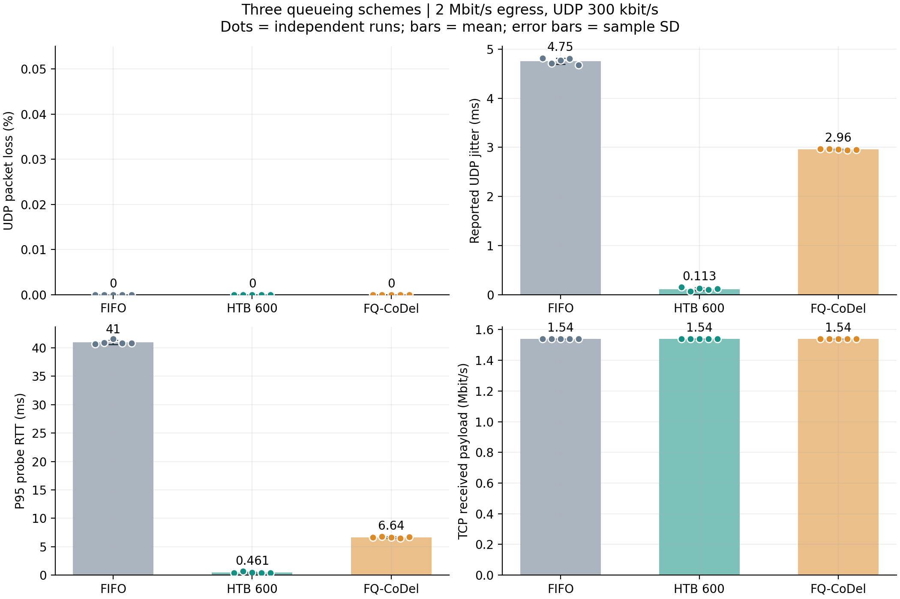
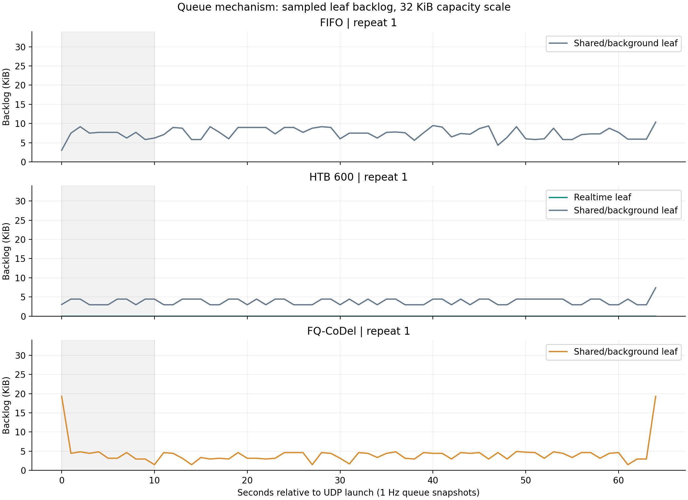
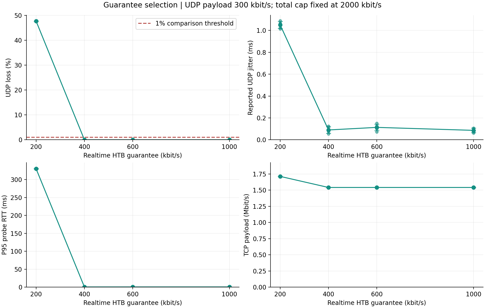
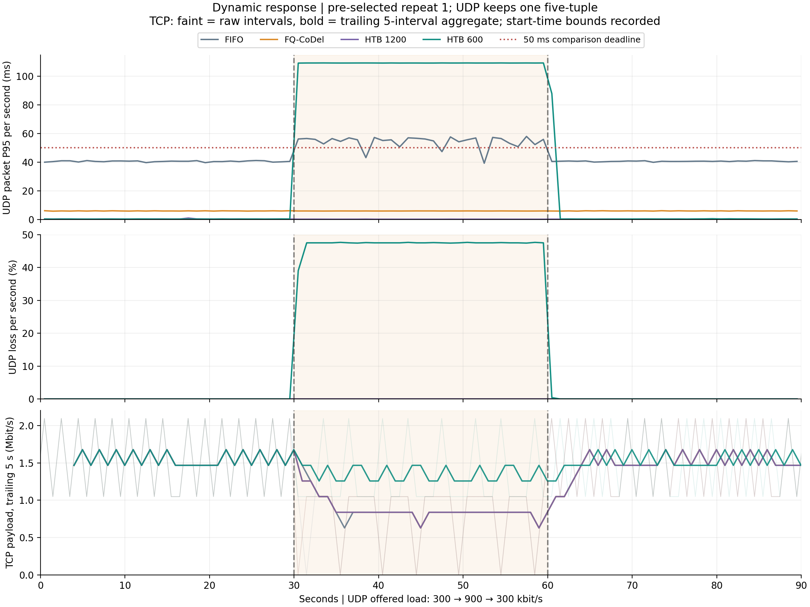
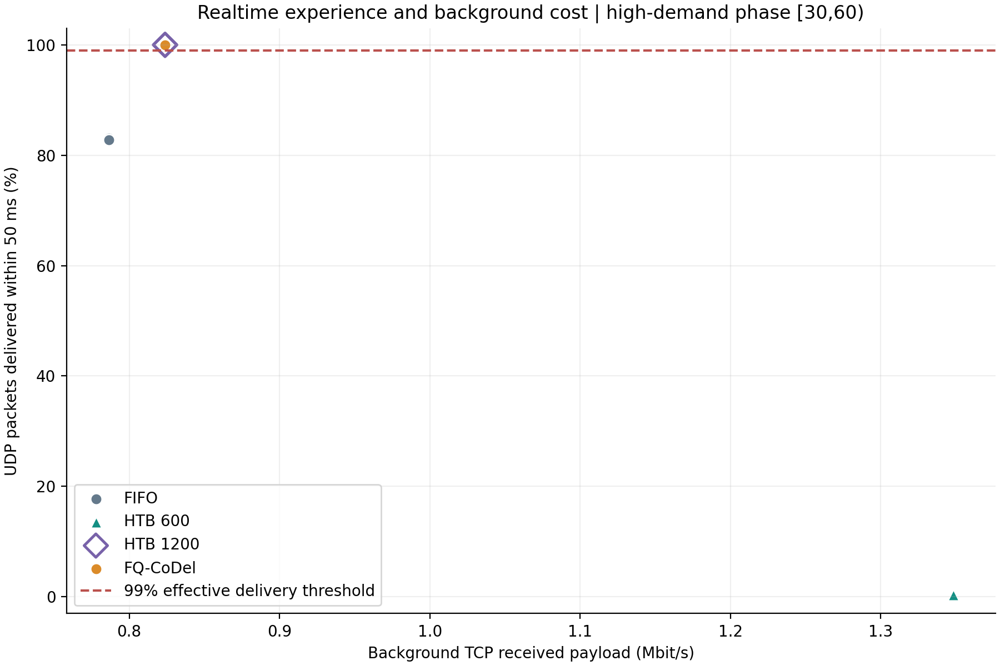
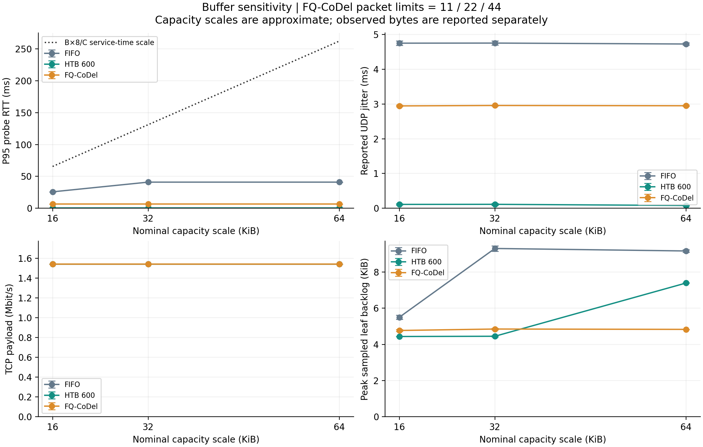

# 实验C扩展实验结果与阅读说明

**对象：** FIFO、分类HTB、FQ-CoDel；服务器出口统一2 Mbit/s，实时UDP与后台TCP共享出口。
**数据：** 72轮有效正式实验；所有正式配置采用同一组冻结源码哈希与同一公共拓扑哈希。图表误差线为独立重复的样本标准差。

本轮高需求阶段，FQ-CoDel与HTB1200的50 ms内有效交付比例分别为100.000 ± 0.000%和100.000 ± 0.000%；UDP包P95分别为6.005 ± 0.005 ms和0.277 ± 0.006 ms。FIFO虽然没有丢包，但部分包超过了50 ms；HTB600的保障份额则不足以满足该峰值需求。以下逐项解释原因和取舍。

## 1. 先理解测量对象

UDP代表实时业务，TCP代表持续下载。我们关心UDP能否及时、完整地到达，同时观察下载吞吐的代价。静态实验采用iperf3；动态实验用同一条带序号和发送时间戳的UDP流，连续改变发送速率。
静态jitter是iperf3估计值；静态RTT来自ICMP探测。动态包时延则是同一内核、同一时间命名空间中，应用发送至应用接收的单向时延，包含协议栈、网络和进程调度影响。三种数值分别解释。

P95表示95%的已观测样本时延不超过这个值，丢失的包需另看丢包率。jitter描述到达间隔的波动：如果每个包都稳定地晚100 ms，jitter仍可很小。因此同时查看“丢了多少、晚了多久、是否按时到达”。吞吐量表示每秒实际交付的载荷；0.3 Mbit/s就是300 kbit/s。

## 2. 三种方法的基准比较

共同条件：UDP载荷300 kbit/s、160字节，一条饱和后台TCP，60秒一轮，排除前10秒；名义缓存32 KiB量级。

| 方法 | n | UDP丢包率 % | UDP jitter ms | 探测RTT P95 ms | TCP载荷 Mbit/s |
|---|---:|---:|---:|---:|---:|
| FIFO | 5 | 0.000 ± 0.000 | 4.755 ± 0.059 | 40.960 ± 0.365 | 1.541 ± 0.000 |
| 分类HTB | 5 | 0.000 ± 0.000 | 0.113 ± 0.031 | 0.461 ± 0.120 | 1.541 ± 0.000 |
| FQ-CoDel | 5 | 0.000 ± 0.000 | 2.958 ± 0.012 | 6.640 ± 0.120 | 1.541 ± 0.000 |

看图顺序：先看丢包，再看抖动和探测时延，最后核对TCP吞吐。低丢包、低时延需要同时成立；只看其中一个指标容易误判。RTT P95表格给的是“每轮P95的均值”，不是合并全部探测点后的P95。

## 3. 机制：用实际积压解释时延

| 方法，32 KiB量级 | 稳态平均叶队列积压 KiB | 每轮稳态采样峰值的组均值 KiB |
|---|---:|---:|
| FIFO | 7.387 ± 0.270 | 9.304 ± 0.150 |
| 分类HTB，仅实时叶队列 | 0.000 ± 0.000 | 0.000 ± 0.000 |
| FQ-CoDel | 3.766 ± 0.037 | 4.849 ± 0.043 |

32 KiB按2 Mbit/s服务的时间量级约131.072 ms。这个值表示整块缓存的服务时间；实际队列没有填满时，时延会明显低于它。应以观测到的积压解释结果，不把缓存上限直接当作实测P95。
HTB把实时与后台业务分到不同叶队列，实时体验主要看实时叶队列；后台队列很长，也不能据此认定实时包同样等待。FQ-CoDel同时采用流隔离和主动队列管理，本实验三组比较反映两者的综合效果。

两个满载实时队列的对照更直观。后台持续繁忙、实时类接近其保障速率服务时，8192字节队列在200 kbit/s下的服务时间约327.68 ms，在600 kbit/s下约109.23 ms：

| 场景 | 满队列服务时间估算 | 实测指标与组均值±SD |
|---|---:|---:|
| 静态HTB200，实时保障不足 | 327.68 ms | 探测RTT P95：330.200 ± 0.447 ms |
| 动态HTB600，高需求阶段 | 109.23 ms | UDP包时延P95：109.155 ± 0.004 ms |
 
两行的观测指标分别是探测RTT和UDP单向时延，均用于核对主要排队分量的量级，不将它们混成同一种时延。估算不是分位数公式，也不构成逐包时延保证。

队列按1 Hz采样，图中峰值仅指“采样峰值”。时间分辨率不足以恢复每包排队时间，也不能单凭曲线相关性把全部应用时延归因于一个队列。

| 基准方法 | 整次叶队列丢弃 | FQ硬包数/内存超限丢弃 | 整次TCP数据重传 | 稳态TCP重传 次/s |
|---|---:|---:|---:|---:|
| FIFO | 0.0 ± 0.0 | — | 0.0 ± 0.0 | 0.000 ± 0.000 |
| 分类HTB | 1.0 ± 0.0 | — | 0.0 ± 0.0 | 0.000 ± 0.000 |
| FQ-CoDel | 8.0 ± 0.0 | 0.0 ± 0.0 | 3.0 ± 0.0 | 0.000 ± 0.000 |

整次计数含启动与预热，稳态重传按同一保守时间窗口取TCP发送端记录；两者的时间范围不同。队列丢弃还可能包含控制报文，不能直接等同于UDP丢包或TCP数据重传。HTB overlimits是限速等待计数，也不等于丢包。
FQ-CoDel的主动拥塞反馈可以作用于TCP，而UDP业务仍保持完整交付；要结合硬上限丢弃、TCP重传和接收端UDP丢包共同判断。仅凭总drops不能量化AQM与流隔离各自贡献。

## 4. HTB保障份额怎么选

| 实时/后台保障 kbit/s | n | UDP丢包率 % | UDP jitter ms | 探测RTT P95 ms | TCP载荷 Mbit/s |
|---|---:|---:|---:|---:|---:|
| 200/1800 | 5 | 47.723 ± 0.004 | 1.052 ± 0.032 | 330.200 ± 0.447 | 1.712 ± 0.000 |
| 400/1600 | 5 | 0.000 ± 0.000 | 0.090 ± 0.030 | 0.430 ± 0.043 | 1.541 ± 0.000 |
| 600/1400 | 5 | 0.000 ± 0.000 | 0.113 ± 0.031 | 0.461 ± 0.120 | 1.541 ± 0.000 |
| 1000/1000 | 5 | 0.000 ± 0.000 | 0.086 ± 0.020 | 0.498 ± 0.120 | 1.541 ± 0.000 |

在所测试候选中，所有重复都通过静态UDP丢包≤1%门槛的最低份额为：400 kbit/s。它是本场景的候选选参结果；静态没有测UDP包级时延，不能据此宣称通过动态50 ms截止期。
300 kbit/s是UDP载荷速率。计入常见IPv4、UDP和以太网头后，队列流量约379 kbit/s，还需留出ICMP及突发余量。因此200不足，400接近需求，600提供更多余量。丢包严重时，幸存包的jitter仍可能不大，不能把这种情况解释为服务更好。
HTB两个子类均允许借用空闲容量。保障份额不是硬上限，增加预留也不意味着低负载时必然浪费带宽；需要结合实际TCP吞吐判断。

## 5. 动态需求：300 → 900 → 300 kbit/s

每轮90秒，30秒与60秒切换，保持同一个UDP五元组。初始统计窗口[10,30)，高需求[30,60)，回落[60,90)，包含切换后的瞬态。50 ms是本实验的工程比较截止期。

| 方法 | 阶段 | n | UDP丢包 % | UDP包P95 ms | 50 ms内有效交付 % | TCP载荷 Mbit/s |
|---|---|---:|---:|---:|---:|---:|
| FIFO | 初始300 | 3 | 0.000 ± 0.000 | 40.574 ± 0.033 | 100.000 ± 0.000 | 1.515 ± 0.000 |
| FIFO | 高需求900 | 3 | 0.000 ± 0.000 | 55.663 ± 0.041 | 82.855 ± 0.252 | 0.786 ± 0.000 |
| FIFO | 回落300 | 3 | 0.000 ± 0.000 | 40.614 ± 0.027 | 100.000 ± 0.000 | 1.535 ± 0.000 |
| 分类HTB 600 | 初始300 | 3 | 0.000 ± 0.000 | 0.344 ± 0.030 | 100.000 ± 0.000 | 1.515 ± 0.000 |
| 分类HTB 600 | 高需求900 | 3 | 47.238 ± 0.016 | 109.155 ± 0.004 | 0.379 ± 0.000 | 1.348 ± 0.000 |
| 分类HTB 600 | 回落300 | 3 | 0.014 ± 0.000 | 0.434 ± 0.071 | 99.488 ± 0.000 | 1.573 ± 0.000 |
| 分类HTB 1200 | 初始300 | 3 | 0.000 ± 0.000 | 0.370 ± 0.029 | 100.000 ± 0.000 | 1.515 ± 0.000 |
| 分类HTB 1200 | 高需求900 | 3 | 0.000 ± 0.000 | 0.277 ± 0.006 | 100.000 ± 0.000 | 0.824 ± 0.000 |
| 分类HTB 1200 | 回落300 | 3 | 0.000 ± 0.000 | 0.329 ± 0.012 | 100.000 ± 0.000 | 1.535 ± 0.000 |
| FQ-CoDel | 初始300 | 3 | 0.000 ± 0.000 | 6.018 ± 0.013 | 100.000 ± 0.000 | 1.515 ± 0.000 |
| FQ-CoDel | 高需求900 | 3 | 0.000 ± 0.000 | 6.005 ± 0.005 | 100.000 ± 0.000 | 0.824 ± 0.000 |
| FQ-CoDel | 回落300 | 3 | 0.000 ± 0.000 | 6.042 ± 0.012 | 100.000 ± 0.000 | 1.535 ± 0.000 |

有效交付比例的分母是成功发送包数，只有在50 ms内收到的包计入分子。因此丢失和迟到都会降低体验；只对已收到的包计算P95时，必须同时查看丢包。
动态UDP的分期吞吐按发送时间归属：统计该阶段发送、随后成功收到的载荷，包括排空期迟到包；它不是按接收时刻划分的瞬时速率。
900 kbit/s载荷计入头部后约1136 kbit/s。后台TCP持续繁忙时，HTB600无法依靠不存在的空闲份额满足该需求；HTB1200是检查“提高固定保障能否解决”的必要对照。
FQ-CoDel按流调度并优待间歇性稀疏流，不能简单推定两条应用流始终各分一半，也不能把它称为识别应用重要性的智能控制器。以实测交付、时延和TCP代价评价它。

| 方法 | 回落恢复时间，秒 |
|---|---:|
| FIFO | 0.0 ± 0.0 |
| 分类HTB 600 | 1.0 ± 0.0 |
| 分类HTB 1200 | 0.0 ± 0.0 |
| FQ-CoDel | 0.0 ± 0.0 |

恢复时间定义：t=60之后，按1秒步长搜索，首次存在连续5秒窗口，同时满足丢包≤1%、已收包P95≤50 ms和有效交付≥99%，取窗口起点减60。0秒表示回落后的首个5秒窗口已达标；没有达标不能记0。

## 6. 缓存敏感性

比较16/32/64 KiB量级。FIFO按字节限制，HTB按1:3分配给实时与后台；FQ-CoDel分别限制11/22/44包。包数与字节数不能完全等价，因此同时展示实际积压。

| 方法 | 缓存量级 KiB | n | 探测RTT P95 ms | UDP jitter ms | TCP载荷 Mbit/s |
|---|---:|---:|---:|---:|---:|
| FIFO | 16 | 5 | 25.760 ± 0.089 | 4.752 ± 0.062 | 1.541 ± 0.000 |
| FIFO | 32 | 5 | 40.960 ± 0.365 | 4.755 ± 0.059 | 1.541 ± 0.000 |
| FIFO | 64 | 5 | 40.960 ± 0.422 | 4.728 ± 0.031 | 1.541 ± 0.000 |
| 分类HTB | 16 | 5 | 0.396 ± 0.012 | 0.111 ± 0.019 | 1.541 ± 0.000 |
| 分类HTB | 32 | 5 | 0.461 ± 0.120 | 0.113 ± 0.031 | 1.541 ± 0.000 |
| 分类HTB | 64 | 5 | 0.417 ± 0.023 | 0.080 ± 0.014 | 1.541 ± 0.000 |
| FQ-CoDel | 16 | 5 | 6.640 ± 0.031 | 2.946 ± 0.022 | 1.541 ± 0.000 |
| FQ-CoDel | 32 | 5 | 6.640 ± 0.120 | 2.958 ± 0.012 | 1.541 ± 0.000 |
| FQ-CoDel | 64 | 5 | 6.646 ± 0.062 | 2.950 ± 0.018 | 1.541 ± 0.000 |

FIFO从16增至32 KiB时，探测P95上升；继续增至64 KiB时基本持平。实际采样积压也没有随上限继续翻倍，所以不能用“配置缓存越大，实测时延必然同比增大”解释本轮数据。分类HTB的实时队列与FQ-CoDel在本次缓存范围内更稳定。
FQ-CoDel硬包数超限与CoDel主动丢弃的计数需分开查看，不把所有丢弃都归因于CoDel。缓存测试使用300 kbit/s静态负载，900 kbit/s峰值下的交付目标应依据动态实验判定。

### 方案选择

本轮900 kbit/s峰值下，HTB1200实现更低的UDP包时延；FQ-CoDel同时通过50 ms交付目标，并省去逐业务的端口分类与保障份额配置。可以把两者作为“明确业务保障”和“通用流隔离及排队治理”的对照。静态400 kbit/s通过丢包门槛，只说明它适合本次300 kbit/s静态需求，不能直接用于未经验证的更高峰值。

## 7. 实施条件与复现边界

- 现场公共拓扑、信道1/6及AP设置保持一致，整形只作用于srv仿真接口。所有正式测试串行持有同一共享锁，每轮使用独立Python进程并重建拓扑。
- 三组统一关闭相关卸载，并对srv设置gso_max_size=1514、gso_max_segs=1，MTU1500；FQ最终maxpacket不超过1514，避免聚合大包使包数缓存比较失真。
- HTB burst/cburst统一4096字节。本轮发送形态和显式参数与v1.0不同，使用本轮统一重测的结果作三组比较，旧结果单独保留。
- tc 6.1的类JSON、重复u32 match字段、微秒舍入均有兼容处理，保留原始文本和原始JSON作为证据。
- 每轮检查接收socket和网络命名空间UDP错误。静态iperf结束后的队列尾包可能到达已关闭端口，NoPorts独立记录；它与RcvbufErrors溢出分别处理。动态接收器额外收包2秒。
- TCP阶段统计使用实测启动时间上下界，只纳入确定完全落入窗口的接收区间；因此边界少量区间被排除。逐秒TCP字节可能量化，结论以阶段汇总为主。
- TCP默认接收读块为128 KiB时，一个读块在49秒窗口约对应0.0214 Mbit/s，在28秒窗口约对应0.0374 Mbit/s。块级量化会造成逐秒锯齿，也限制微小吞吐差异的解释；不能把接近一个读块的差别当作确定的效率优势。实际读块大小保存在audit.json。
- 本实验研究云服务器上的Mininet-WiFi仿真和人为出口瓶颈。结果支撑该部署场景下的方案选择，不直接代表真实Wi-Fi驱动、硬件队列或任意无线环境的表现。

资源核查：静态组每轮CPU忙碌均值范围为51.02%—56.39%；动态组为5.34%—6.38%。两套发生器不同，分别在各自组内比较。全部正式轮最大steal为0.00%，最大采样延后约1.80 ms；接收溢出、发包与窗口完整性检查通过。

## 8. 如何查看交付

- `results/formal_runs.csv`：每轮汇总；动态行的主要UDP指标对应高需求阶段。
- `results/phases.csv`：动态三阶段分别统计。
- `results/summary.json`：分配置均值、样本标准差及有效重复数。
- `results/audit.json`：来源一致性、配置稳定、原始指标重算与资源核查。
- `merged_logs/`：每轮一个JSONL，保存原文件路径、UTF-8内容和SHA-256；包含预检异常，正式结果仅统计有效正式轮。
- `protocol.md`与`analysis_preregistration.md`：实验矩阵、指标与补测约定。
- `progress.md`：实现与现场兼容处理的完整决策记录。

复现：用`python3 tools/restore_logs.py merged_logs <新日志目录>`校验并还原；用`python3 tools/audit.py <交付根目录> <新日志目录>`重算审计。绘图还需要matplotlib和numpy。

方法依据：[RFC 8290](https://www.rfc-editor.org/rfc/rfc8290.html)、[tc-fq_codel](https://man7.org/linux/man-pages/man8/tc-fq_codel.8.html)、[tc-htb](https://man7.org/linux/man-pages/man8/tc-htb.8.html)。这些来源支撑算法与参数说明，表中数值均来自本轮实验。
