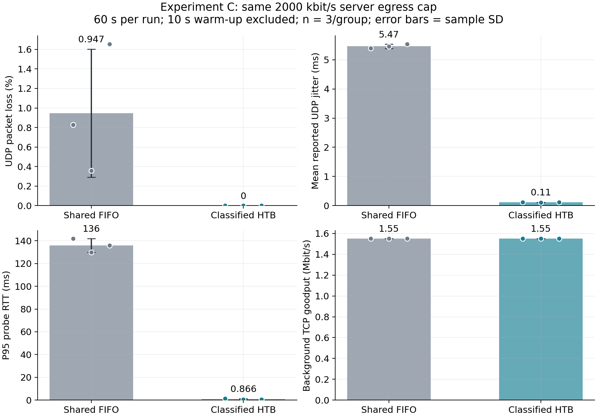
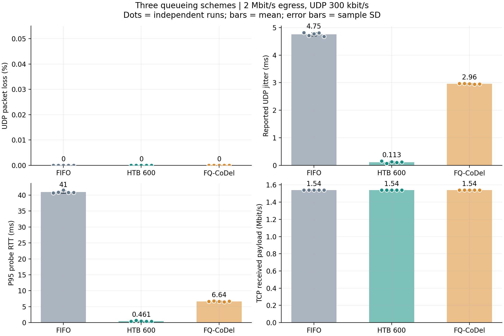
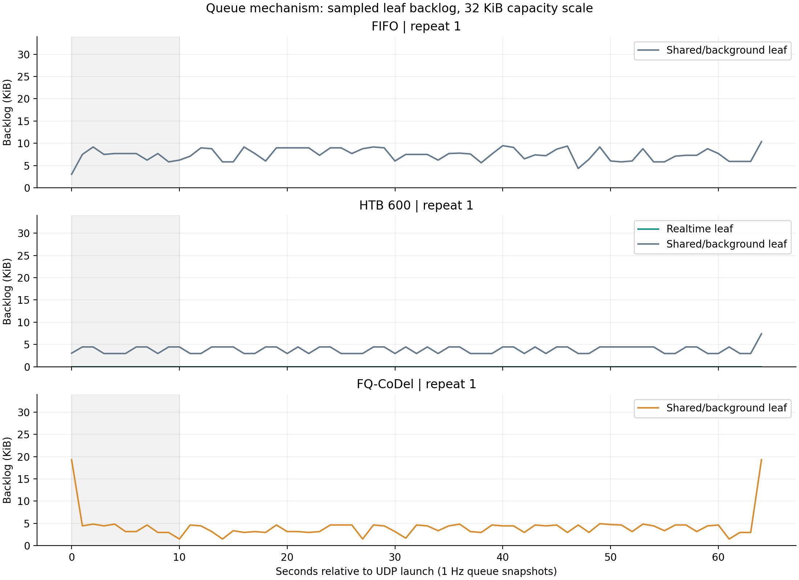
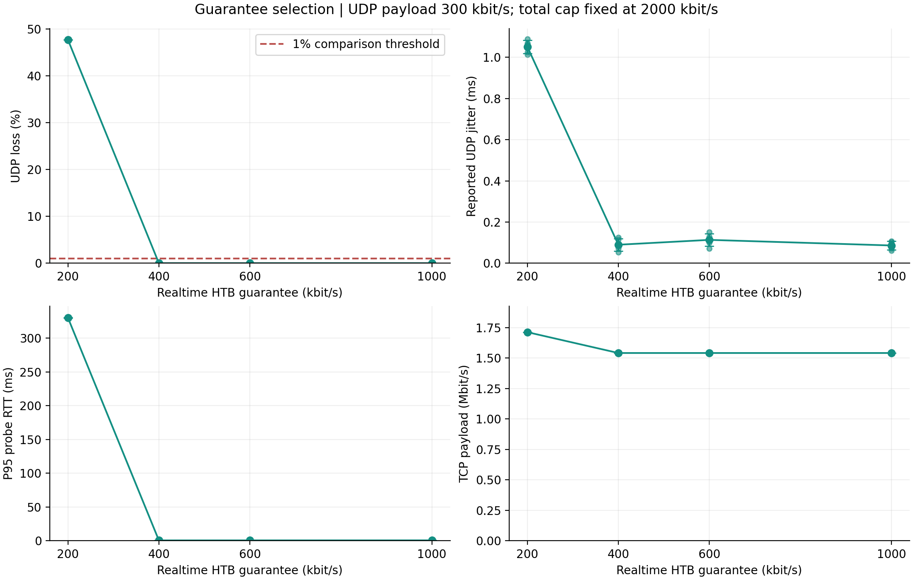
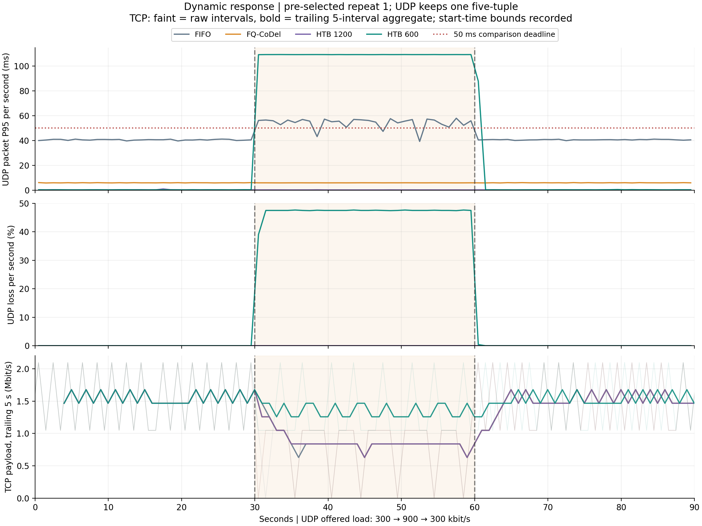
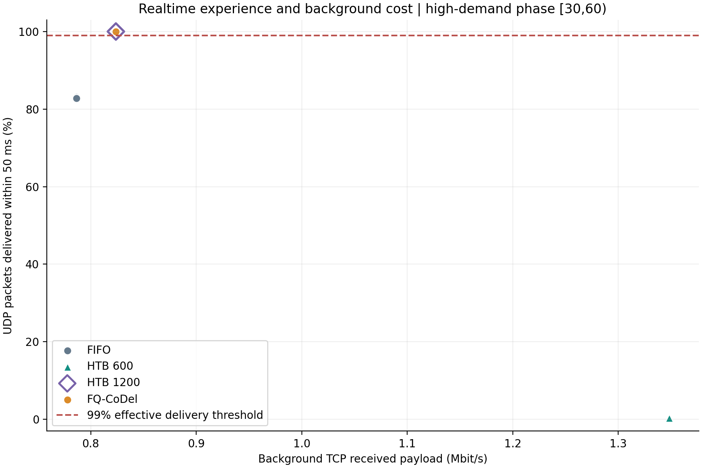
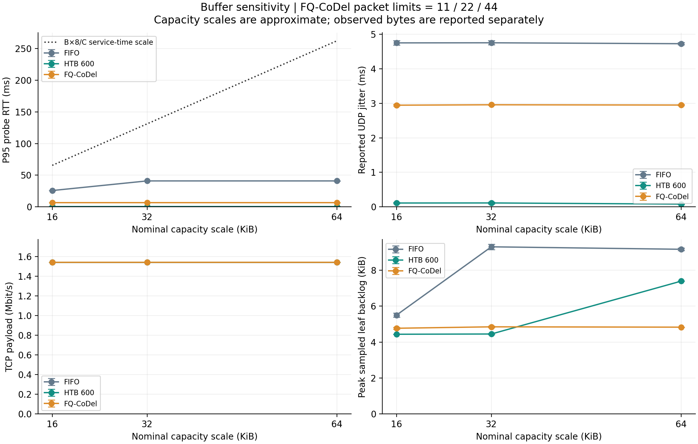

# 实验C统一结果报告：实时UDP与后台TCP的出口QoS保障

负责人：6号。统一整理日期：2026年11月12日。

## 1. 结论与阅读入口

本项目已完成两阶段共**78轮有效正式实验**：前期验证v1.0共6轮，统一条件主实验v1.1共72轮。主实验覆盖三种方法、保障份额扫描、动态需求和缓存敏感性。两阶段形成同一条实验主线，保留各自的版本、参数和独立统计。

主要结论如下：

1. **分类保障有效，但份额应覆盖实际需求。** 前期6轮确认了FIFO与分类HTB的差异；主实验在统一条件下重测FIFO、HTB，并加入FQ-CoDel，完成可直接比较的三组对照。
2. **本次300 kbit/s静态负载下，400 kbit/s是通过丢包门槛的最低已测HTB候选。** 200 kbit/s明显不足；600和1000 kbit/s没有带来可据此宣称更优的整体业务结论。选参还须考虑业务峰值及协议开销。
3. **900 kbit/s高需求阶段，FQ-CoDel和HTB1200均满足本实验50 ms交付目标。** FQ-CoDel的UDP包P95为6.005 ± 0.005 ms，HTB1200为0.277 ± 0.006 ms，两者50 ms内有效交付均为100%。FIFO虽未丢包，但部分包迟到；HTB600则因保障不足出现大量丢包和积压。
4. **时延应结合实际积压解释。** FIFO从16增至32 KiB时探测时延上升，32增至64 KiB后基本持平。缓存上限不是实际队列长度，也不是P95预测值。

本报告以第4节的72轮作为正式主结果，第3节的6轮作为前期验证。图表、逐轮数据、原始日志、脚本和审计通过第6节统一索引。原始日志均为可还原JSONL，不使用压缩包。

## 2. 实验问题、环境与统计口径

实验模拟服务器向两个无线终端下发实时UDP与持续TCP下载，共享一个2 Mbit/s服务器出口。两个终端分别接入两个AP，干预点为srv-eth0出口队列。两阶段公共拓扑哈希一致，沿用802.11g、20 MHz、信道1/6及实际AP功率1 dBm。下行容量标定约36 Mbit/s，使2 Mbit/s软件出口成为主要研究瓶颈。

| 阶段 | 用途 | 正式轮数 | 独立重复与时长 | 统计来源 |
|---|---|---:|---|---|
| v1.0，前期验证 | 验证分类HTB相对FIFO的作用 | 6 | 2配置×3次；每次60秒 | 对应版本的审计通过记录 |
| v1.1，统一条件主实验 | 三组对照、机制、选参、动态需求、缓存敏感性 | 72 | 静态12配置×5次×60秒；动态4配置×3次×90秒 | 对应版本原始记录重算审计 |

v1.1的72轮由基础矩阵48轮与按既定波动规则追加的24轮组成。参考组在多个分析中复用，计数时只计算一次；不能把参考组重复出现的表格行当成新增实验。容量标定、短试跑及无效预检不计入78轮正式实验。

三种方法均使用相同的HTB总限速器。共享FIFO只有一个业务队列；分类HTB分离实时与后台队列并给出保障份额；FQ-CoDel按网络流分队并实施主动队列管理。HTB两类的ceil均为2 Mbit/s，可以借用空闲容量，保障份额不等于硬性最高速率。

| 指标 | 读法与口径 |
|---|---|
| UDP丢包率 | 正式业务中未成功收到的比例；动态按发送序号与接收序号匹配 |
| 静态UDP jitter | iperf3逐秒抖动估计的每轮均值，描述波动，不等于平均时延 |
| 探测RTT | ICMP往返时延；分类HTB中ICMP应答也进入实时类 |
| 动态UDP包时延 | 同一时钟条件下应用发送至应用接收的单向时延，与RTT分别解释 |
| P95 | 95%的已观测样本不超过该值；表中为每轮P95的均值±样本标准差 |
| 50 ms内有效交付 | 截止期内收到的包数/成功发送包数；迟到与丢失均不能算有效交付 |
| TCP吞吐 | 接收端实际载荷速率；按安全覆盖的完整区间汇总 |

静态UDP统计后50秒。动态负载在同一UDP五元组中保持300→900→300 kbit/s，每阶段30秒，主窗口为[10,30)、[30,60)、[60,90)，保留切换后的瞬态。动态TCP只选确定完全落入窗口的接收区间；动态逐轮汇总CSV的主要UDP指标对应高需求阶段，RTT字段仍对应全程探测窗口。

## 3. 前期验证：建立现象与研究问题（v1.0，6轮）

前期在相同2 Mbit/s出口和300 kbit/s UDP负载下，对共享FIFO与分类HTB600各运行3次。以下数值来自v1.0审计通过的60秒正式组，未混入15秒短试跑。

| 前期验证方法 | n | UDP丢包 % | UDP jitter ms | 探测RTT P95 ms | TCP载荷 Mbit/s |
|---|---:|---:|---:|---:|---:|
| 共享FIFO | 3 | 0.947 ± 0.657 | 5.466 ± 0.074 | 136.000 ± 6.000 | 1.552 ± 0.000 |
| 分类HTB | 3 | 0.000 ± 0.000 | 0.110 ± 0.007 | 0.866 ± 0.463 | 1.552 ± 0.000 |



前期结果表明，分类HTB能够降低实时业务的丢包、抖动及探测等待，后台TCP汇总吞吐基本相近。这形成了后续三个问题：队列积压如何解释时延、保障份额如何选择、实时需求突增时不同方案如何取舍。v1.0完整交付已按原布局保存在[历史快照](history/v1.0_original_delivery/README.md)，其原始校验清单可独立验证。

## 4. 统一条件下的正式主结果（v1.1，72轮）

本节所有方法均来自v1.1统一重测。静态每配置5次，动态每配置3次；统计样本为独立运行，不把数据包或逐秒点当成独立重复。

### 4.1 三种方法的基准比较

共同条件：UDP载荷300 kbit/s、160字节，一条饱和后台TCP，60秒一轮，排除前10秒；名义缓存32 KiB量级。

| 方法 | n | UDP丢包率 % | UDP jitter ms | 探测RTT P95 ms | TCP载荷 Mbit/s |
|---|---:|---:|---:|---:|---:|
| FIFO | 5 | 0.000 ± 0.000 | 4.755 ± 0.059 | 40.960 ± 0.365 | 1.541 ± 0.000 |
| 分类HTB | 5 | 0.000 ± 0.000 | 0.113 ± 0.031 | 0.461 ± 0.120 | 1.541 ± 0.000 |
| FQ-CoDel | 5 | 0.000 ± 0.000 | 2.958 ± 0.012 | 6.640 ± 0.120 | 1.541 ± 0.000 |



看图顺序：先看丢包，再看抖动和探测时延，最后核对TCP吞吐。低丢包、低时延需要同时成立；只看其中一个指标容易误判。RTT P95表格给的是“每轮P95的均值”，不是合并全部探测点后的P95。

### 4.2 机制：用实际积压解释时延

| 方法，32 KiB量级 | 稳态平均叶队列积压 KiB | 每轮稳态采样峰值的组均值 KiB |
|---|---:|---:|
| FIFO | 7.387 ± 0.270 | 9.304 ± 0.150 |
| 分类HTB，仅实时叶队列 | 0.000 ± 0.000 | 0.000 ± 0.000 |
| FQ-CoDel | 3.766 ± 0.037 | 4.849 ± 0.043 |

32 KiB按2 Mbit/s服务的时间量级约131.072 ms。这个值表示整块缓存的服务时间；实际队列没有填满时，时延会明显低于它。应以观测到的积压解释结果，不把缓存上限直接当作实测P95。
HTB把实时与后台业务分到不同叶队列，实时体验主要看实时叶队列；后台队列很长，也不能据此认定实时包同样等待。FQ-CoDel同时采用流隔离和主动队列管理，本实验三组比较反映两者的综合效果。

两个满载实时队列的对照更直观。后台持续繁忙、实时类接近其保障速率服务时，8192字节队列在200 kbit/s下的服务时间约327.68 ms，在600 kbit/s下约109.23 ms：

| 场景 | 满队列服务时间估算 | 实测指标与组均值±SD |
|---|---:|---:|
| 静态HTB200，实时保障不足 | 327.68 ms | 探测RTT P95：330.200 ± 0.447 ms |
| 动态HTB600，高需求阶段 | 109.23 ms | UDP包时延P95：109.155 ± 0.004 ms |
 
两行的观测指标分别是探测RTT和UDP单向时延，均用于核对主要排队分量的量级，不将它们混成同一种时延。估算不是分位数公式，也不构成逐包时延保证。



队列按1 Hz采样，图中峰值仅指“采样峰值”。时间分辨率不足以恢复每包排队时间，也不能单凭曲线相关性把全部应用时延归因于一个队列。

| 基准方法 | 整次叶队列丢弃 | FQ硬包数/内存超限丢弃 | 整次TCP数据重传 | 稳态TCP重传 次/s |
|---|---:|---:|---:|---:|
| FIFO | 0.0 ± 0.0 | — | 0.0 ± 0.0 | 0.000 ± 0.000 |
| 分类HTB | 1.0 ± 0.0 | — | 0.0 ± 0.0 | 0.000 ± 0.000 |
| FQ-CoDel | 8.0 ± 0.0 | 0.0 ± 0.0 | 3.0 ± 0.0 | 0.000 ± 0.000 |

整次计数含启动与预热，稳态重传按同一保守时间窗口取TCP发送端记录；两者的时间范围不同。队列丢弃还可能包含控制报文，不能直接等同于UDP丢包或TCP数据重传。HTB overlimits是限速等待计数，也不等于丢包。
FQ-CoDel的主动拥塞反馈可以作用于TCP，而UDP业务仍保持完整交付；要结合硬上限丢弃、TCP重传和接收端UDP丢包共同判断。仅凭总drops不能量化AQM与流隔离各自贡献。

### 4.3 HTB保障份额怎么选

| 实时/后台保障 kbit/s | n | UDP丢包率 % | UDP jitter ms | 探测RTT P95 ms | TCP载荷 Mbit/s |
|---|---:|---:|---:|---:|---:|
| 200/1800 | 5 | 47.723 ± 0.004 | 1.052 ± 0.032 | 330.200 ± 0.447 | 1.712 ± 0.000 |
| 400/1600 | 5 | 0.000 ± 0.000 | 0.090 ± 0.030 | 0.430 ± 0.043 | 1.541 ± 0.000 |
| 600/1400 | 5 | 0.000 ± 0.000 | 0.113 ± 0.031 | 0.461 ± 0.120 | 1.541 ± 0.000 |
| 1000/1000 | 5 | 0.000 ± 0.000 | 0.086 ± 0.020 | 0.498 ± 0.120 | 1.541 ± 0.000 |



在所测试候选中，所有重复都通过静态UDP丢包≤1%门槛的最低份额为：400 kbit/s。它是本场景的候选选参结果；静态没有测UDP包级时延，不能据此宣称通过动态50 ms截止期。
300 kbit/s是UDP载荷速率。计入常见IPv4、UDP和以太网头后，队列流量约379 kbit/s，还需留出ICMP及突发余量。因此200不足，400接近需求，600提供更多余量。丢包严重时，幸存包的jitter仍可能不大，不能把这种情况解释为服务更好。
HTB两个子类均允许借用空闲容量。保障份额不是硬上限，增加预留也不意味着低负载时必然浪费带宽；需要结合实际TCP吞吐判断。

### 4.4 动态需求：300 → 900 → 300 kbit/s

每轮90秒，30秒与60秒切换，保持同一个UDP五元组。初始统计窗口[10,30)，高需求[30,60)，回落[60,90)，包含切换后的瞬态。50 ms是本实验的工程比较截止期。

| 方法 | 阶段 | n | UDP丢包 % | UDP包P95 ms | 50 ms内有效交付 % | TCP载荷 Mbit/s |
|---|---|---:|---:|---:|---:|---:|
| FIFO | 初始300 | 3 | 0.000 ± 0.000 | 40.574 ± 0.033 | 100.000 ± 0.000 | 1.515 ± 0.000 |
| FIFO | 高需求900 | 3 | 0.000 ± 0.000 | 55.663 ± 0.041 | 82.855 ± 0.252 | 0.786 ± 0.000 |
| FIFO | 回落300 | 3 | 0.000 ± 0.000 | 40.614 ± 0.027 | 100.000 ± 0.000 | 1.535 ± 0.000 |
| 分类HTB 600 | 初始300 | 3 | 0.000 ± 0.000 | 0.344 ± 0.030 | 100.000 ± 0.000 | 1.515 ± 0.000 |
| 分类HTB 600 | 高需求900 | 3 | 47.238 ± 0.016 | 109.155 ± 0.004 | 0.379 ± 0.000 | 1.348 ± 0.000 |
| 分类HTB 600 | 回落300 | 3 | 0.014 ± 0.000 | 0.434 ± 0.071 | 99.488 ± 0.000 | 1.573 ± 0.000 |
| 分类HTB 1200 | 初始300 | 3 | 0.000 ± 0.000 | 0.370 ± 0.029 | 100.000 ± 0.000 | 1.515 ± 0.000 |
| 分类HTB 1200 | 高需求900 | 3 | 0.000 ± 0.000 | 0.277 ± 0.006 | 100.000 ± 0.000 | 0.824 ± 0.000 |
| 分类HTB 1200 | 回落300 | 3 | 0.000 ± 0.000 | 0.329 ± 0.012 | 100.000 ± 0.000 | 1.535 ± 0.000 |
| FQ-CoDel | 初始300 | 3 | 0.000 ± 0.000 | 6.018 ± 0.013 | 100.000 ± 0.000 | 1.515 ± 0.000 |
| FQ-CoDel | 高需求900 | 3 | 0.000 ± 0.000 | 6.005 ± 0.005 | 100.000 ± 0.000 | 0.824 ± 0.000 |
| FQ-CoDel | 回落300 | 3 | 0.000 ± 0.000 | 6.042 ± 0.012 | 100.000 ± 0.000 | 1.535 ± 0.000 |



有效交付比例的分母是成功发送包数，只有在50 ms内收到的包计入分子。因此丢失和迟到都会降低体验；只对已收到的包计算P95时，必须同时查看丢包。
动态UDP的分期吞吐按发送时间归属：统计该阶段发送、随后成功收到的载荷，包括排空期迟到包；它不是按接收时刻划分的瞬时速率。
900 kbit/s载荷计入头部后约1136 kbit/s。后台TCP持续繁忙时，HTB600无法依靠不存在的空闲份额满足该需求；HTB1200是检查“提高固定保障能否解决”的必要对照。
FQ-CoDel按流调度并优待间歇性稀疏流，不能简单推定两条应用流始终各分一半，也不能把它称为识别应用重要性的智能控制器。以实测交付、时延和TCP代价评价它。



| 方法 | 回落恢复时间，秒 |
|---|---:|
| FIFO | 0.0 ± 0.0 |
| 分类HTB 600 | 1.0 ± 0.0 |
| 分类HTB 1200 | 0.0 ± 0.0 |
| FQ-CoDel | 0.0 ± 0.0 |

恢复时间定义：t=60之后，按1秒步长搜索，首次存在连续5秒窗口，同时满足丢包≤1%、已收包P95≤50 ms和有效交付≥99%，取窗口起点减60。0秒表示回落后的首个5秒窗口已达标；没有达标不能记0。

### 4.5 缓存敏感性

比较16/32/64 KiB量级。FIFO按字节限制，HTB按1:3分配给实时与后台；FQ-CoDel分别限制11/22/44包。包数与字节数不能完全等价，因此同时展示实际积压。



| 方法 | 缓存量级 KiB | n | 探测RTT P95 ms | UDP jitter ms | TCP载荷 Mbit/s |
|---|---:|---:|---:|---:|---:|
| FIFO | 16 | 5 | 25.760 ± 0.089 | 4.752 ± 0.062 | 1.541 ± 0.000 |
| FIFO | 32 | 5 | 40.960 ± 0.365 | 4.755 ± 0.059 | 1.541 ± 0.000 |
| FIFO | 64 | 5 | 40.960 ± 0.422 | 4.728 ± 0.031 | 1.541 ± 0.000 |
| 分类HTB | 16 | 5 | 0.396 ± 0.012 | 0.111 ± 0.019 | 1.541 ± 0.000 |
| 分类HTB | 32 | 5 | 0.461 ± 0.120 | 0.113 ± 0.031 | 1.541 ± 0.000 |
| 分类HTB | 64 | 5 | 0.417 ± 0.023 | 0.080 ± 0.014 | 1.541 ± 0.000 |
| FQ-CoDel | 16 | 5 | 6.640 ± 0.031 | 2.946 ± 0.022 | 1.541 ± 0.000 |
| FQ-CoDel | 32 | 5 | 6.640 ± 0.120 | 2.958 ± 0.012 | 1.541 ± 0.000 |
| FQ-CoDel | 64 | 5 | 6.646 ± 0.062 | 2.950 ± 0.018 | 1.541 ± 0.000 |

FIFO从16增至32 KiB时，探测P95上升；继续增至64 KiB时基本持平。实际采样积压也没有随上限继续翻倍，所以不能用“配置缓存越大，实测时延必然同比增大”解释本轮数据。分类HTB的实时队列与FQ-CoDel在本次缓存范围内更稳定。
FQ-CoDel硬包数超限与CoDel主动丢弃的计数需分开查看，不把所有丢弃都归因于CoDel。缓存测试使用300 kbit/s静态负载，900 kbit/s峰值下的交付目标应依据动态实验判定。

#### 方案选择

本轮900 kbit/s峰值下，HTB1200实现更低的UDP包时延；FQ-CoDel同时通过50 ms交付目标，并省去逐业务的端口分类与保障份额配置。可以把两者作为“明确业务保障”和“通用流隔离及排队治理”的对照。静态400 kbit/s通过丢包门槛，只说明它适合本次300 kbit/s静态需求，不能直接用于未经验证的更高峰值。


## 5. 两阶段结果如何衔接

### 5.1 参数变化与结果解释

| 项目 | v1.0前期验证 | v1.1统一条件主实验 |
|---|---|---|
| 总出口与基本静态业务 | 2 Mbit/s；UDP300 kbit/s、160字节；后台单TCP | 保持相同研究条件，并加入动态需求 |
| 方法范围 | FIFO、分类HTB600 | FIFO、分类HTB与FQ-CoDel；HTB扫描多个份额 |
| HTB burst/cburst | 使用工具自动计算值 | 父/子类显式固定4096字节 |
| 卸载与聚合控制 | 未采用本轮统一的卸载及GSO尺寸约束 | 统一关闭相关卸载，srv的gso_max_size=1514、gso_max_segs=1 |
| TCP启动与覆盖 | UDP/TCP近同时启动，各自60秒 | 先确认TCP数据，再启动UDP；TCP额外运行4秒，并记录启动上下界 |
| 动态业务 | 未测 | 同一条UDP流连续变速，记录序号及发送/接收时间戳 |
| 独立重复 | 每配置3次 | 静态5次、动态3次 |
| 数据用途 | 证明现象、形成后续问题 | 方法排名、参数选择和动态适应性的主依据 |

因此，v1.0 FIFO探测P95约136 ms，而v1.1约40.960 ms，是不同实施条件下的观测。不能把这一跨版本差值算成某个算法的提升，也不能把两版本同名方法合成n=8。两阶段都显示分类保障能改善实时体验；主报告的三方法比较、选参与结论使用v1.1统一条件数据。

### 5.2 主结果的实施条件与核查

- 现场公共拓扑、信道1/6及AP设置保持一致，整形只作用于srv仿真接口。所有正式测试串行持有同一共享锁，每轮使用独立Python进程并重建拓扑。
- 三组统一关闭相关卸载，并对srv设置gso_max_size=1514、gso_max_segs=1，MTU1500；FQ最终maxpacket不超过1514，避免聚合大包使包数缓存比较失真。
- HTB burst/cburst统一4096字节。本轮发送形态和显式参数与v1.0不同，使用本轮统一重测的结果作三组比较，旧结果单独保留。
- tc 6.1的类JSON、重复u32 match字段、微秒舍入均有兼容处理，保留原始文本和原始JSON作为证据。
- 每轮检查接收socket和网络命名空间UDP错误。静态iperf结束后的队列尾包可能到达已关闭端口，NoPorts独立记录；它与RcvbufErrors溢出分别处理。动态接收器额外收包2秒。
- TCP阶段统计使用实测启动时间上下界，只纳入确定完全落入窗口的接收区间；因此边界少量区间被排除。逐秒TCP字节可能量化，结论以阶段汇总为主。
- TCP默认接收读块为128 KiB时，一个读块在49秒窗口约对应0.0214 Mbit/s，在28秒窗口约对应0.0374 Mbit/s。块级量化会造成逐秒锯齿，也限制微小吞吐差异的解释；不能把接近一个读块的差别当作确定的效率优势。实际读块大小保存在audit.json。
- 本实验研究云服务器上的Mininet-WiFi仿真和人为出口瓶颈。结果支撑该部署场景下的方案选择，不直接代表真实Wi-Fi驱动、硬件队列或任意无线环境的表现。

资源核查：静态组每轮CPU忙碌均值范围为51.02%—56.39%；动态组为5.34%—6.38%。两套发生器不同，分别在各自组内比较。全部正式轮最大steal为0.00%，最大采样延后约1.80 ms；接收溢出、发包与窗口完整性检查通过。


## 6. 统一数据、证据与复现

| 入口 | 内容 |
|---|---|
| [78轮统一明细](unified_results/formal_runs_78.csv) | 每轮保留版本、用途、配置、独立重复、指标窗口及日志位置 |
| [分版本18组汇总](unified_results/summary_by_version.json) | v1.0两组＋v1.1十六组；均值与标准差按版本分别核对 |
| [动态36个阶段明细](unified_results/dynamic_phases_36.csv) | 12轮动态测试×3阶段，均属于v1.1 |
| [来源索引](unified_results/source_index.json) | 两版本审计、汇总、日志索引及SHA-256 |
| [统一结果核查](unified_results/validation.json) | 78轮唯一编号、组计数、源均值/SD及校验清单核对 |
| [主实验方案](wifi-qos/extension_v1.1/protocol.md) | 环境、完整矩阵、队列参数及验收规则 |
| [补测与统计约定](wifi-qos/extension_v1.1/analysis_preregistration.md) | 原始3次触发、固定完成第4/5次、共享参考组与顺序 |
| [前期原始交付](history/v1.0_original_delivery/README.md) | 原报告、脚本、6轮正式数据、预检及原校验清单 |
| [主实验完整交付](wifi-qos/extension_v1.1/README.md) | 72轮正式数据、脚本、图表、审计与合并日志 |

两阶段的规范日志索引共指向106份JSONL，保存71,573份原始文件；其中包括预检证据。历史快照与旧路径中的兼容副本不增加统计样本，统一数据仅按“版本＋运行ID”登记一次。

在相应版本的交付目录使用还原脚本即可无损恢复原始日志，目标须是新目录。前期交付在历史快照内运行原脚本；主实验按其README依次执行还原、审计、统计和绘图。统一结果可在项目根目录用下列命令重建：

```bash
python3 unified_results/build_unified.py
```

重建程序读取两版本已通过审计的数据，核对逐轮值与原组汇总，并保留各版本的统计边界。当前项目的校验清单为`FILES_UNIFIED.sha256`；v1.0原清单位于历史快照中，v1.1自身的`FILES.sha256`保持不变。

## 7. 结果使用与组内交接

6号汇报可围绕“前期发现→机制解释→参数选择→动态需求与后台代价”展开，三方法排名与主要图表选用第4节。7号可以通过统一明细追溯两版本日志，分别复算；8号制作图表时筛选`version=v1.1`、`role=primary`，再按业务、方法、保障份额和缓存分组。静态jitter、探测RTT、动态UDP单向时延分别标注。

2号参数回填以实际部署值及本报告为准：信道1/6、AP实际1 dBm、总出口配置2000 kbit/s；容量标定值不是配置的无线bw。三号与七号的联合抽样复现仍应按分工独立执行，本次已有重复与离线重算不替代该联合复现。

方法依据：[FQ-CoDel RFC 8290](https://www.rfc-editor.org/rfc/rfc8290.html)、[tc-fq_codel手册](https://man7.org/linux/man-pages/man8/tc-fq_codel.8.html)、[tc-htb手册](https://man7.org/linux/man-pages/man8/tc-htb.8.html)。方法资料说明算法与参数，所有结果数值来自本项目实验记录。
